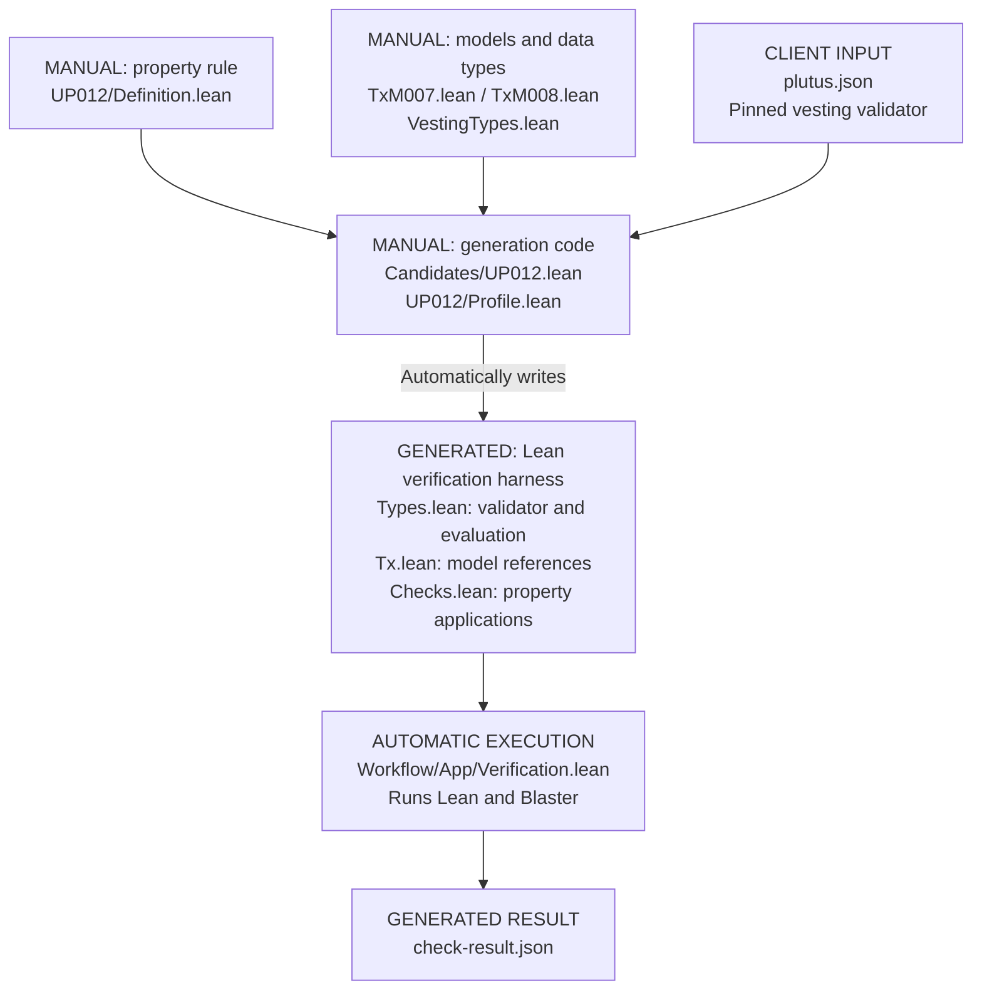

# Current workflow

UP-012 example. We maintain the property, models, and generation code;
the tool creates the verification harness for each run.

`Tx.lean` imports our model definitions. This UP-012 profile accepts only
the pinned vesting artifact.

Sources: [property](../Formal/Properties/Universal/UP012/Definition.lean),
[Claim model](../Formal/TxModels/Definitions/TxM007.lean),
[Cancel model](../Formal/TxModels/Definitions/TxM008.lean),
[data types](../Formal/TxModels/VestingTypes.lean),
[check adapter](../Candidates/UP012.lean),
[profile](../Workflow/Tests/UP012/Profile.lean), and
[verification](../Workflow/App/Verification.lean).
