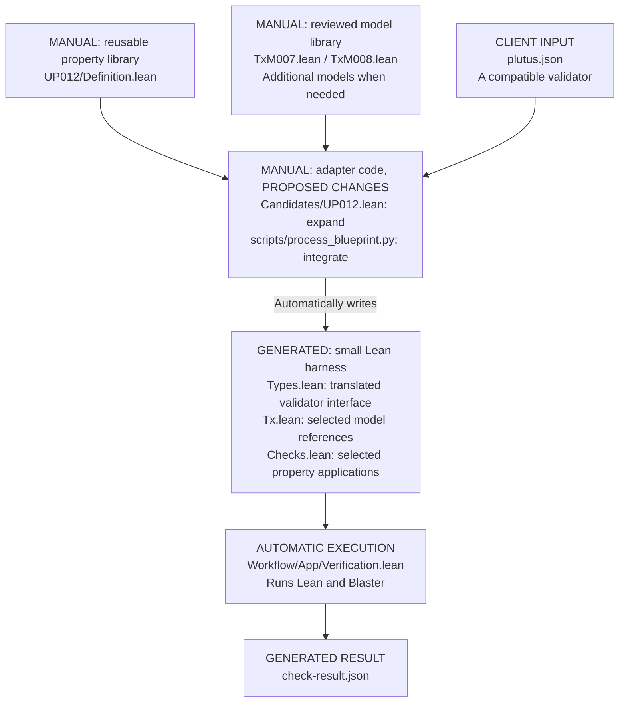

# Proposed workflow

Proposal for discussion. Expand the adapter to support compatible validator
interfaces, using our reviewed property and model libraries.

The library separation already exists. The proposed change replaces pinned
scenario wiring with a reusable adapter and integrates blueprint type translation.
Only compatible, reviewed property/model/validator combinations would run.

Existing code to reuse or extend: [property](../Formal/Properties/Universal/UP012/Definition.lean),
[models](../Formal/TxModels/Index.lean),
[adapter](../Candidates/UP012.lean),
[type translator](../scripts/process_blueprint.py), and
[verification](../Workflow/App/Verification.lean).
